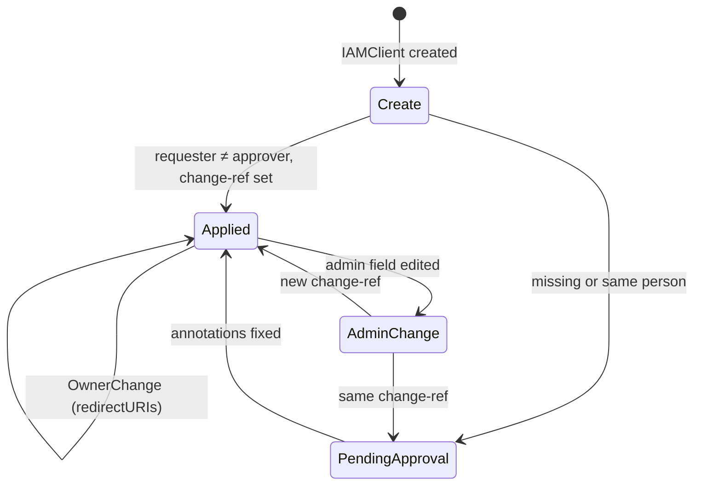

# Approvals and change kinds

**Admins create, owners maintain.** Creating a client, deleting it, or
changing any admin-only field needs a platform admin and a change reference.
The owning team can change `spec.redirectURIs` on its own authority.

This is enforced twice: at admission (who may write what; see
[RBAC and admission](../reference/rbac.md)) and by the controller before it
touches Entra (the approval gate described here). The second check means a
misconfigured or missing admission policy cannot open the door on its own.

## The approval annotations

| Annotation | Meaning |
|---|---|
| `iam.rbc.example/requested-by` | Who asked for the change |
| `iam.rbc.example/approved-by` | Who approved it; must differ from the requester (case-insensitive) |
| `iam.rbc.example/change-ref` | The change ticket, e.g. `CHG0012345` |
| `iam.rbc.example/last-modified-by` | Stamped by admission from the authenticated user; any value written by hand is overwritten |

Only admins may set the first three; admission rejects anyone else changing them.

## Two hashes

The controller hashes the spec (SHA-256 over canonical JSON, keys sorted):

- the **spec hash** covers the whole spec,
- the **admin hash** covers every field except `redirectURIs`.

`status.appliedAdminHash` is the admin hash the current Entra state was
applied under, and `status.changeRef` the change reference it was applied with.

## Change kinds

| Kind | When | Gate |
|---|---|---|
| `Create` | Nothing applied yet (no `appliedAdminHash`) | Requester, a different approver, and a change reference must all be present |
| `AdminChange` | The admin hash differs from `appliedAdminHash` | As for `Create`, **and** the change reference must differ from `status.changeRef` |
| `OwnerChange` | The admin hash is unchanged (only `redirectURIs` changed, or nothing) | None: applied on the owner's authority, recorded with `last_modified_by` |

So an admin change made without a new ticket stops with `Ready=False`,
reason `PendingApproval`, message "admin-only fields changed without a new
change-ref", and nothing is applied. Setting a new change reference resumes it.

## Owner changes are still policed

An owner change skips the approval gate but not the policy check: redirect
URIs must still be HTTPS on an allowed domain with no wildcards. The
admission policy applies the same rules at write time, so most bad values are
rejected before they are stored.

## Turning approval off

`REQUIRE_APPROVAL=false` disables the gate (development only). Each change is
then recorded as `approval_check` / `info` with reason
"approval disabled by config", so the fact that it was off is in the audit trail.

## Adding a field to the CRD

New optional fields are omitted from the serialised spec when unset, so adding
a field to the CRD does not change the admin hash of existing clients and does
not force them all to be re-approved. A unit test guards this for
`pushSecret`. New owner-editable fields must be added to both
`OWNER_EDITABLE` in `src/policy.rs` and the admission policy.
