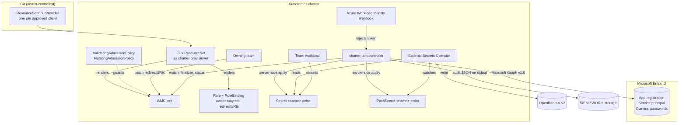

# Architecture

## Components

| Component | Responsibility |
|---|---|
| `IAMClient` | The request and the system of record for intent. |
| Flux ResourceSet | The admin provisioning path. Renders an `IAMClient` and a per-client owner `Role` from each approved input provider. |
| Admission policies | Only admins create, delete or change admin-only fields; owners only change `redirectURIs`; the author is stamped on every write. |
| `charter-iam` | Converges Entra to the `IAMClient`, delivers credentials, writes status and audit records. The only component that talks to Graph. |
| `Secret <name>-entra` | The delivered credentials. Always written. Owned by the `IAMClient`. |
| `PushSecret <name>-entra` | Optional. Tells External Secrets Operator to copy the Secret to OpenBao. |
| Entra ID | Holds the app registration, service principal, owners and passwords. |

## Trust boundaries

1. **Admin to cluster.** Only platform admins and the Flux provisioner can
   create clients or change admin-only fields. Enforced by admission and
   re-checked by the controller (approval gate).
2. **Owner to cluster.** An owning team has RBAC on its own `IAMClient` only,
   and admission limits it to `redirectURIs` within the allowed domains.
3. **Controller to Entra.** Workload identity, no stored secret. The
   permission `Application.ReadWrite.OwnedBy` confines the blast radius to
   registrations the controller created.
4. **Controller to consumers.** Credentials are only ever written to the
   client's own namespace (Secret) and to a path the controller derives
   (OpenBao). The team cannot choose where its secret goes.

See the [threat model](../security/threat-model.md) for the threats at each boundary.

## Design decisions

- **Fail closed.** Approval is required unless `REQUIRE_APPROVAL=false`;
  redirect domains and push stores must be allow-listed; loopback redirects are
  off by default; an empty allow-list refuses everything.
- **Idempotency through `uniqueName`.** Graph's upsert on an alternate key
  (`PATCH /applications(uniqueName='...')` with `Prefer: create-if-missing`)
  means a crash or a lost status never creates a duplicate app.
- **Status is not trusted for secrets.** Which password is delivered is read
  from the Secret's annotations, which are written in the same request as the
  secret value, so the two cannot disagree after a crash.
- **Retain by default on delete.** Secrets are revoked and the registration is
  kept as evidence.
- **Calls Graph directly.** No dependency on Azure Service Operator or
  Crossplane. The Graph module could be replaced by one that writes their
  objects; the reconcile shape stays the same.
- **Single writer.** One replica, no leader election yet.

## Code map

| Module | Contents |
|---|---|
| `src/main.rs` | Startup, `crd` subcommand |
| `src/crd.rs` | `IAMClient` types (the CRD is generated from these) |
| `src/controller.rs` | Reconcile and cleanup |
| `src/policy.rs` | Policy settings, approval gate, spec hashing |
| `src/graph.rs` | Minimal Microsoft Graph client and token acquisition |
| `src/push.rs` | `PushSecret` rendering and sync status |
| `src/audit.rs` | Audit records and Kubernetes Events |

More in [code layout](../developer/code-layout.md).
