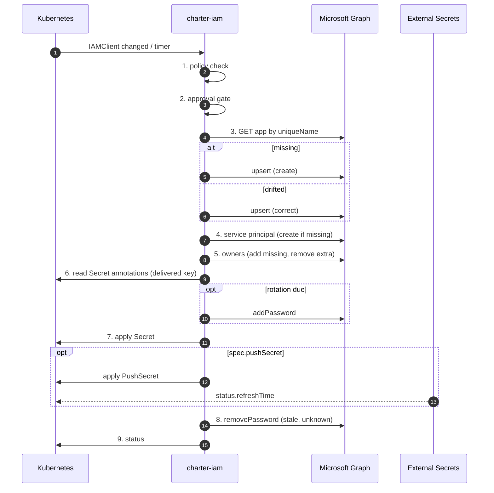

# The reconcile loop

Each time an `IAMClient` (or its Secret) changes, and on a timer, the controller
runs the steps below in order. Nothing in Entra changes unless steps 1 and 2
pass.

## Step by step

### 1. Policy check

Every rule is evaluated and all violations are reported together:

- `secretRotation` parses (`90d`, `720h`, `30m`), is between 1 hour and 730
  days, and is not above `MAX_SECRET_LIFETIME_DAYS`;
- at least one owner;
- every redirect URI is absolute, HTTPS, has no wildcard, and its host equals
  or is under an allowed domain (loopback only with `ALLOW_LOCALHOST_REDIRECTS=true`);
- `dex.issuerURL`, if set, passes the same redirect rules;
- `pushSecret`, if set, resolves to an allow-listed `ClusterSecretStore`.

On failure: a `policy_check` / `denied` record, `Ready=False` with reason
`PolicyViolation`, and no further action until the object changes.

### 2. Approval gate

The controller classifies the change by comparing the hash of the admin-only
fields with the hash last applied (`status.appliedAdminHash`). See
[approvals and change kinds](approval-model.md). On failure: an
`approval_check` / `denied` record, `Ready=False` with reason `PendingApproval`,
and no further action until the object changes.

### 3. App registration

The desired app body is:

| Property | Value |
|---|---|
| `displayName` | `<NAME_PREFIX><spec.displayName>` |
| `signInAudience` | `AzureADMyOrg` (single tenant) |
| `web.redirectUris` | `spec.redirectURIs`, or only `<dex.issuerURL>/callback` with Dex |
| `groupMembershipClaims` | `ApplicationGroup` if `spec.groups` is set, else `None` |
| `tags` | `charter`, `k8s:<namespace>/<name>`, `spec:<first 16 hex of spec hash>` |
| `notes` | Who manages it, the change reference, and a warning not to edit by hand |

If the app is missing it is created (`create_application`). If it exists and
differs, a `drift_detected` record lists the fields and it is corrected
(`update_application`). See [drift detection](drift.md).

### 4. Service principal

Created if missing (`create_service_principal`), so users can sign in.

### 5. Owners

The owner set is made exactly `spec.owners` plus the controller itself.
Missing owners are added (`add_owner`); unexpected ones are recorded as drift
and removed (`remove_owner`). The controller never removes itself: it would
lose access to the app.

### 6. Client secret decision

The Secret's annotations say which Entra password is delivered. A new password
is issued (`add_password`) when:

| Reason | When |
|---|---|
| `initial_or_missing` | No delivered key, it no longer exists in Entra, or the Secret lost its `client-secret` |
| `rotation` | A third or less of the lifetime is left, or the expiry is unknown |
| `lifetime_shortened` | The secret would outlive the currently approved `secretRotation` |

If the Secret says a key was delivered in the last 10 minutes but Graph does
not list it yet, the controller treats it as replication lag: it changes
nothing and looks again in 15 seconds. See
[secret lifecycle](secret-lifecycle.md#replication-lag).

### 7. Delivery

The Secret `<name>-entra` is written with server-side apply, owned by the
`IAMClient`. With a new password this is `deliver_secret`. With
`spec.pushSecret`, the `PushSecret` is applied when its rendered spec changes
(`apply_push_secret`), or deleted when the field is removed
(`delete_push_secret`).

### 8. Revocation

Every Entra password except the delivered one is removed (`remove_password`),
with two exceptions for the previously delivered key: it is kept during the
grace window, and it is kept until OpenBao holds its replacement when
`spec.pushSecret` is set. Passwords the controller never delivered (added by
hand in the portal) are removed with reason `unknown_credential`.

### 9. Status and next run

Status records the IDs, the delivered key and expiry, the approval evidence and
the conditions (see [status](../reference/status.md)). The next run is:

| Situation | Requeue |
|---|---|
| Healthy | At the next rotation time, clamped between 1 minute and 1 hour (so drift is checked at least hourly) |
| Push to OpenBao pending | 30 seconds |
| Delivered key not visible yet | 15 seconds |
| Graph or Kubernetes error | 30 seconds |
| Invalid object | 5 minutes |
| `PolicyViolation` or `PendingApproval` | When the object next changes |

## Deletion

The finalizer `iam.rbc.example/entra-cleanup` holds the object until cleanup
succeeds:

1. the `PushSecret` is deleted, which makes External Secrets delete the OpenBao copy;
2. with `deletionPolicy: Retain` (default) every password is revoked and the
   registration is kept (`retain_application`); with `Delete` the app is
   deleted, which Entra keeps soft-deleted for 30 days (`delete_application`);
3. the Secret is garbage-collected through its owner reference.

## Concurrency

The controller runs one reconcile per object at a time and one replica. Entra
is eventually consistent, so a reconcile that starts right after another can
read slightly old data; [troubleshooting](../guides/troubleshooting.md#replication-lag)
covers the effects.
