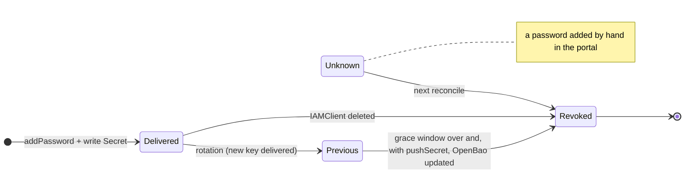

<!-- Copyright (c) 2026 Erick Bourgeois, charter -->
<!-- SPDX-License-Identifier: Apache-2.0 -->

# Secret lifecycle and rotation

Charter issues client secrets, delivers them, rotates them before they expire,
and revokes every secret that is no longer needed. Nobody copies a secret by hand.

## Lifecycle

## Issuing

A password is created with `addPassword`, display name
`charter <YYYY-MM-DD>`, and an end date of now plus `spec.secretRotation`.
The secret text exists only in the controller's memory (as a `SecretString`,
zeroized on drop) and in the Secret it writes.

## Delivery

The Secret `<name>-entra` in the client's namespace holds:

| Key | Content |
|---|---|
| `tenant-id` | Tenant ID |
| `client-id` | Application (client) ID |
| `client-secret` | The current client secret |
| `issuer` | `https://login.microsoftonline.com/<tenant-id>/v2.0` |
| `dex-client-secret` | With `spec.dex`: the Dex static client's secret, generated once and kept |
| `dex-config.yaml` | With `spec.dex`: the Dex configuration fragment |

Its annotations are the controller's memory of what it delivered:

| Annotation | Meaning |
|---|---|
| `iam.rbc.example/key-id` | Key ID of the delivered password |
| `iam.rbc.example/previous-key-id` | Key ID delivered before the last rotation |
| `iam.rbc.example/rotated-at` | When the last new password was delivered |

The value and its key ID are written in one request, so they cannot disagree
after a crash. With `spec.pushSecret`, the same keys are also copied to
OpenBao; see [delivering to OpenBao](../guides/openbao.md).

## Rotation

A new password is issued when any of these holds:

| Reason in the audit record | Condition |
|---|---|
| `rotation` | A third or less of the lifetime is left (day 60 of 90), or Entra reports no end date |
| `lifetime_shortened` | The secret would outlive the currently approved `secretRotation` by more than 5 minutes, for example after an admin shortens it from `90d` to `3h` |
| `initial_or_missing` | No password delivered yet, the delivered one was deleted in Entra, or the Secret lost its `client-secret` |

The controller wakes at least hourly, and at the next rotation time if that is
sooner, so rotation happens without any trigger.

## Revocation

After delivery, every password other than the delivered one is removed, except
the previous one while either of these is true:

- the **grace window** is open (`ROTATION_GRACE_HOURS` after `rotated-at`,
  default 24 hours), so workloads that read the Secret at startup have time to
  restart;
- `spec.pushSecret` is set and External Secrets has **not yet pushed** the new
  secret to OpenBao (its `status.refreshTime` is older than `rotated-at`), so
  workloads reading OpenBao are never left holding a revoked secret.

| Reason | What was removed |
|---|---|
| `rotated_out` | The previous (or a superseded) delivered key |
| `unknown_credential` | A password Charter never delivered, such as one added in the portal |
| `deletion_policy_retain` | Every password, because the client was deleted with `Retain` |

## Replication lag

Microsoft Graph is eventually consistent. For a few seconds after a write,
reads can return the old state. Two consequences are handled explicitly:

- **A new key not listed yet.** If the Secret says a key was delivered in the
  last 10 minutes but Graph does not list it, the controller changes nothing
  and looks again in 15 seconds. Acting on the stale list would mint a second
  secret and revoke the one consumers hold. After 10 minutes a missing key is
  treated as deleted out of band and replaced.
- **A removed key still listed.** The controller may try to remove a key that
  is already gone; Graph answers `404` (treated as success) or a `409`
  concurrency error, and the next pass converges.

## Lifetime limits

| Limit | Value |
|---|---|
| Minimum `secretRotation` | 1 hour |
| Maximum `secretRotation` | 730 days (Entra's own cap), and never above `MAX_SECRET_LIFETIME_DAYS` (default 180) |
| Grace window | `ROTATION_GRACE_HOURS`, default 24 |

A grace window longer than a third of the lifetime means two secrets are
valid most of the time; keep it well below.

For the operator's view (forcing a rotation, emergency revocation) see
[rotating secrets](../guides/rotation.md).
