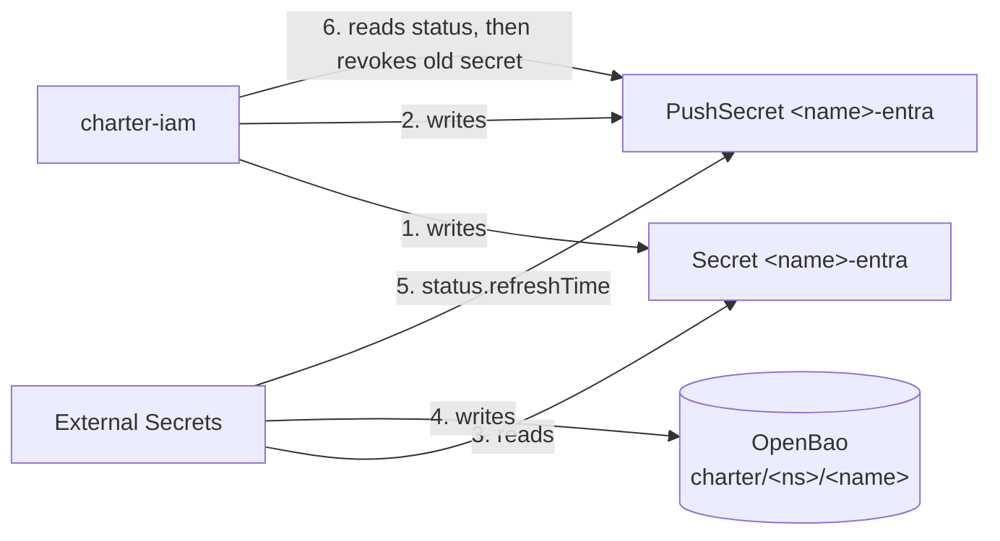

# Delivering to OpenBao

Charter always writes the client's credentials to a Kubernetes Secret. With
`spec.pushSecret` it also copies them to OpenBao (or any secret store External
Secrets Operator can push to) through a `PushSecret`. The controller never
talks to OpenBao itself.



!!! note "PushSecret, not ExternalSecret"
    In External Secrets Operator an `ExternalSecret` pulls from a store into
    Kubernetes. Pushing a Kubernetes Secret into a store is a `PushSecret`.

## 1. Install External Secrets Operator

```sh
helm repo add external-secrets https://charts.external-secrets.io
helm upgrade --install external-secrets external-secrets/external-secrets \
  -n external-secrets --create-namespace --wait
kubectl get crd pushsecrets.external-secrets.io
```

Charter renders `external-secrets.io/v1alpha1` `PushSecret`s; it was tested
with External Secrets 2.15.0 and OpenBao 2.7.2.

## 2. Create a ClusterSecretStore

Use a `ClusterSecretStore` with write access to a KV v2 mount. With token auth:

```yaml
apiVersion: external-secrets.io/v1
kind: ClusterSecretStore
metadata:
  name: openbao
spec:
  provider:
    vault:                     # OpenBao speaks the Vault API
      server: https://openbao.example.com:8200
      path: secret             # KV v2 mount
      version: v2
      auth:
        tokenSecretRef: { name: openbao-token, key: token, namespace: external-secrets }
```

In production prefer Kubernetes auth with a role whose policy only allows
writing under the Charter prefix:

```hcl
path "secret/data/charter/*"     { capabilities = ["create", "update", "read"] }
path "secret/metadata/charter/*" { capabilities = ["read", "delete"] }
```

Check it is ready:

```sh
kubectl get clustersecretstore openbao   # STATUS Valid, CAPABILITIES ReadWrite
```

## 3. Allow the store in Charter

On the controller:

| Variable | Example | Meaning |
|---|---|---|
| `ALLOWED_PUSH_SECRET_STORES` | `openbao` | Comma-separated `ClusterSecretStore` names clients may push to. Empty refuses every push. |
| `DEFAULT_PUSH_SECRET_STORE` | `openbao` | Used when a client gives no store |
| `PUSH_SECRET_PATH_PREFIX` | `charter/` | Path prefix; the remote key is `<prefix><namespace>/<name>` |
| `PUSH_SECRET_REFRESH_INTERVAL` | `1m` | How often External Secrets re-pushes; bounds how long a rotation takes to reach OpenBao |

The controller also needs RBAC on `pushsecrets.external-secrets.io`
(already in `deploy/rbac.yaml`).

## 4. Enable it on a client

`pushSecret` is admin-only, so it needs a new change reference on an existing
client:

```yaml
metadata:
  annotations:
    iam.rbc.example/change-ref: CHG0012399
spec:
  pushSecret: {}                     # the default store
  # or
  pushSecret:
    clusterSecretStore: openbao      # must be allow-listed
```

Through Flux, set `pushSecretStore` on the input provider.

## What happens

- The controller writes a `PushSecret` named `<name>-entra` in the client's
  namespace, owned by the `IAMClient`, that pushes every key of the Secret as
  a property of one secret at the fixed path (`apply_push_secret`).
- `status.pushedTo` is `<store>:<remote key>`; the `SecretPushed` condition
  is `True` once External Secrets has synced.
- On rotation the old Entra secret is kept until External Secrets has pushed
  the new one, then revoked.
- Removing `pushSecret` (with a new change reference) or deleting the client
  deletes the `PushSecret`; with `deletionPolicy: Delete` on the `PushSecret`,
  External Secrets removes the OpenBao secret, including its version history
  (`delete_push_secret`).

## Why teams cannot choose the store or the path

- **Only `ClusterSecretStore`s.** A namespaced `SecretStore` lives in the
  team's namespace; the team could repoint it and send the secret anywhere.
- **Only allow-listed stores.** A typo or a hostile value is refused with
  `PolicyViolation` before anything changes.
- **A fixed path.** `<prefix><namespace>/<name>` means one team cannot write
  into another's path.

## Checking it

```sh
kubectl -n team-payments get pushsecret payments-portal-entra
# NAME                    STATUS   LAST SYNC
# payments-portal-entra   Synced   12s

kubectl -n team-payments get iamc payments-portal \
  -o jsonpath='{range .status.conditions[*]}{.type}={.status} {.reason}{"\n"}{end}'
# Ready=True Reconciled
# SecretPushed=True Synced
```

| `SecretPushed` reason | Meaning |
|---|---|
| `Synced` | External Secrets pushed after the last rotation |
| `Pending` | Waiting for the first push, or for a push after the latest rotation |
| `Failed` | External Secrets reports an error, or the `PushSecret` CRD is not installed; `Ready` is also `False` with reason `PushSecretFailed` |
