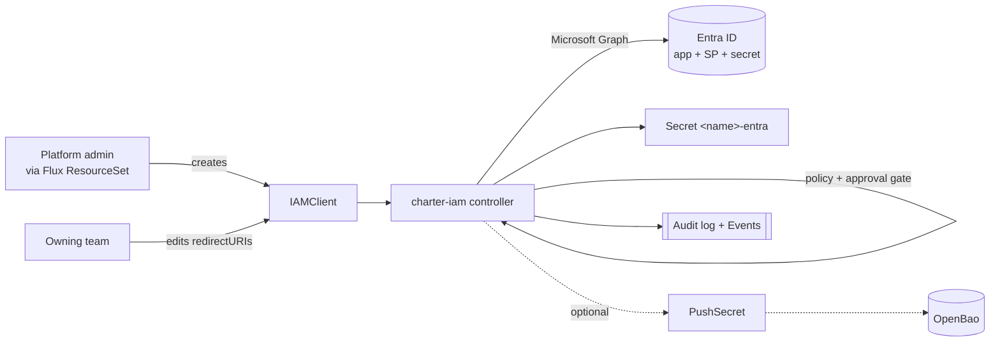

<!-- Copyright (c) 2026 Erick Bourgeois, charter -->
<!-- SPDX-License-Identifier: Apache-2.0 -->

# Charter

*A charter is a grant of rights from an authority: platform admins grant an
identity client, and the owning team operates within it.*

Charter (`charter-iam`) is a Kubernetes controller that turns one `IAMClient`
custom resource into everything an application needs to sign users in with
Microsoft Entra ID:

- an **Entra app registration** and its **service principal**,
- a **client secret** that is rotated automatically and revoked when no longer needed,
- a Kubernetes **Secret** with the credentials, the issuer URL and, optionally,
  a ready-made **Dex** configuration,
- optionally, a copy of those credentials in **OpenBao**, through an External
  Secrets Operator `PushSecret`.

It is built audit- and compliance-first for a regulated environment: nothing
changes in Entra without a policy check and a verified approval, every change
is recorded before and after it happens, and changes made by hand in the Entra
portal are detected and reverted.

```yaml
apiVersion: iam.rbc.example/v1alpha1
kind: IAMClient
metadata:
  name: payments-portal
  namespace: team-payments
  annotations:
    iam.rbc.example/requested-by: alice@example.com
    iam.rbc.example/approved-by: bob@example.com
    iam.rbc.example/change-ref: CHG0012345
spec:
  displayName: Payments Portal
  redirectURIs: [https://payments.apps.example.com/callback]
  owners: [11111111-1111-1111-1111-111111111111]
  secretRotation: 90d
  pushSecret: {}          # optional: also copy the credentials to OpenBao
```



## Where to start

<div class="grid cards" markdown>

- **New here?** Read [Why Charter](why.md), then the
  [architecture overview](concepts/architecture.md).
- **Want to try it?** The [quickstart](getting-started/quickstart.md) runs the
  controller against a local cluster and a development Entra tenant.
- **Operating it?** See the [production install](getting-started/production-install.md)
  and the [controller configuration](reference/configuration.md).
- **Using a client?** See [consuming the credentials](guides/consuming-credentials.md)
  and [editing redirect URIs](guides/owner-self-service.md).
- **Reviewing it?** See [security](security/index.md), the
  [threat model](security/threat-model.md) and the
  [control mapping](security/compliance.md).

</div>

## Status

Charter is pre-production. It has been run end to end against a
non-production Entra tenant (create, drift correction, approval gate,
rotation, OpenBao delivery, deletion). The open items before production are
listed in [Compliance: open items](security/compliance.md#open-items-before-production).
