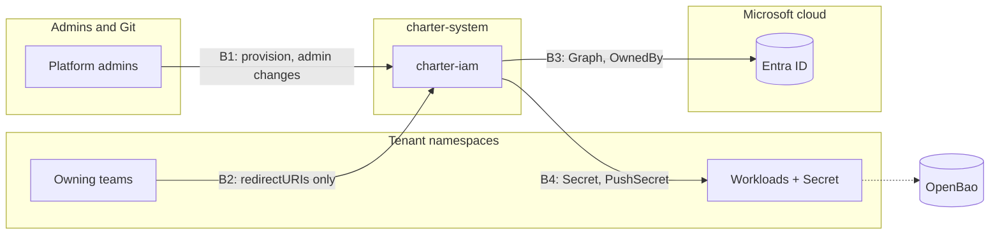

# Threat model

Design-level threat model for Charter. It covers what the design does about
each threat; it is not a record of test findings.

## Assets

| Asset | Why it matters |
|---|---|
| Client secrets of managed apps | Let anyone impersonate the application to Entra |
| The controller's Entra identity | Can create apps and change every app it owns |
| App registration configuration (redirect URIs especially) | A rogue redirect URI lets an attacker receive authorization codes |
| The audit trail | Evidence for every change; must be complete and untampered |
| The approval record | Proves each change was authorised |

## Trust boundaries

## Threats and mitigations

STRIDE category in brackets.

### B1: admins and provisioning

| Threat | Mitigation |
|---|---|
| A single person creates and approves their own client [Elevation] | Requester and approver must differ; checked at admission and by the controller |
| An admin change slips in without a new ticket [Tampering] | The admin-field hash must change together with the change reference, or nothing is applied |
| Flux or Git is compromised and provisions a rogue client [Elevation] | Redirect domain policy still applies; every client is audited with its change reference for reconciliation against the change system |

### B2: owning teams

| Threat | Mitigation |
|---|---|
| An owner adds a redirect URI on an attacker's domain [Spoofing] | Allowed domain list at admission and in the controller; HTTPS only; no wildcards |
| An owner edits an admin-only field, e.g. adds themselves as owner or lengthens secret lifetime [Elevation] | Admission allows only `redirectURIs` to change; the controller's admin hash blocks it without a new change reference |
| An owner forges approval annotations [Spoofing] | Admission rejects non-admin changes to them |
| An owner hides who made a change [Repudiation] | `last-modified-by` is stamped by admission from the authenticated user, overwriting any value |
| An owner redirects their secret to a store they control [Information disclosure] | Only allow-listed `ClusterSecretStore`s; path fixed by the controller |
| An owner reads another team's secret | Secrets are written only in the client's own namespace; OpenBao paths are per namespace and name |

### B3: controller to Entra

| Threat | Mitigation |
|---|---|
| The controller's credential leaks [Spoofing] | No stored credential: workload identity federation with short-lived projected tokens |
| The controller is compromised and modifies other apps [Elevation] | `Application.ReadWrite.OwnedBy`: only apps the controller created |
| Someone edits a managed app in the portal [Tampering] | Drift detection reverts and records it |
| Someone adds a secret in the portal [Spoofing] | Unknown passwords are revoked on the next reconcile |
| A rotation leaves consumers with a revoked secret [Denial of service] | Grace window; with OpenBao delivery, revocation waits for the push |
| Graph's eventual consistency causes duplicate secrets or wrong revocations [Tampering] | `uniqueName` keyed upsert; a recently delivered key that Graph does not list yet is treated as lag, not loss |
| Network path to Graph is intercepted [Information disclosure] | HTTPS only; recommended egress restriction to the two Microsoft endpoints |

### B4: delivery

| Threat | Mitigation |
|---|---|
| Secret value appears in logs or events [Information disclosure] | Held as `SecretString`; records carry key IDs only |
| Secret stays readable after the client is deleted [Information disclosure] | Secrets revoked in Entra; Kubernetes Secret garbage-collected; OpenBao copy deleted with its versions |
| Kubernetes Secret read from etcd or by broad RBAC [Information disclosure] | Out of Charter's scope: KMS encryption at rest and tight Secret RBAC are required in the install checklist |

### The audit trail

| Threat | Mitigation |
|---|---|
| A change happens with no record [Repudiation] | `attempted` is written before every mutation; Entra's own audit log is a second, independent record |
| Records are edited or dropped [Tampering] | Sequence numbers and a hash chain make gaps and edits detectable; immutable SIEM storage is the system of record |

## Out of scope

- Compromise of the Kubernetes control plane or of cluster admins.
- Compromise of Entra itself, or of a Global Administrator.
- How consuming applications protect the secret once they have read it.

## Residual risks and open items

Tracked in [compliance: open items](compliance.md#open-items-before-production),
including leader election, egress restriction, Entra audit log reconciliation,
and a penetration test before production onboarding.
